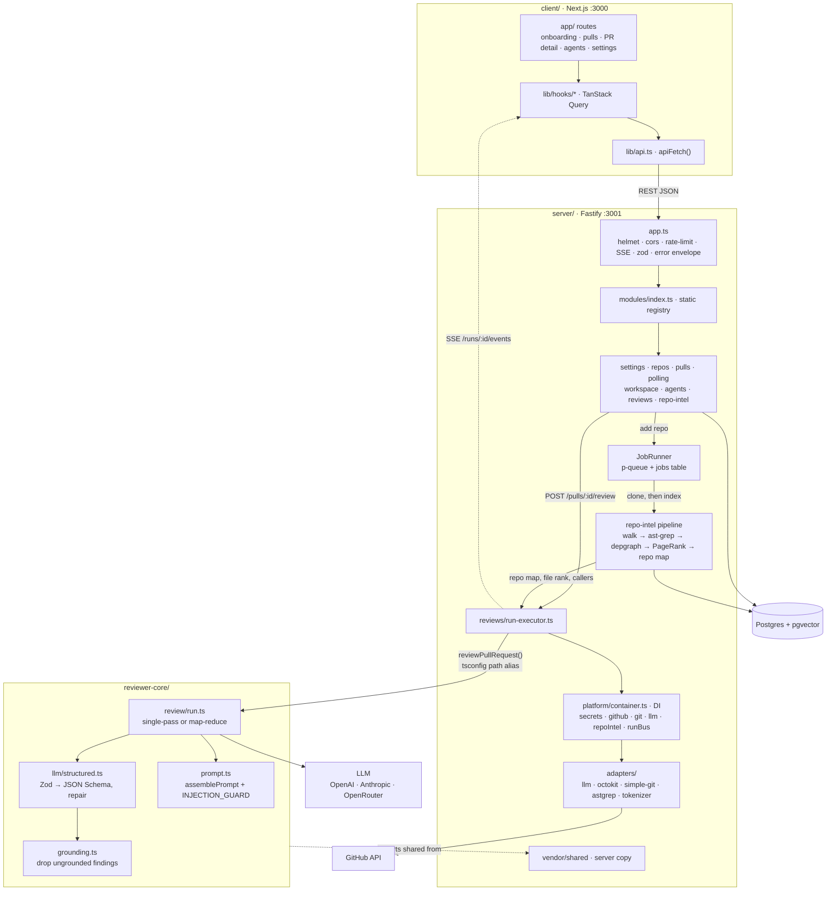
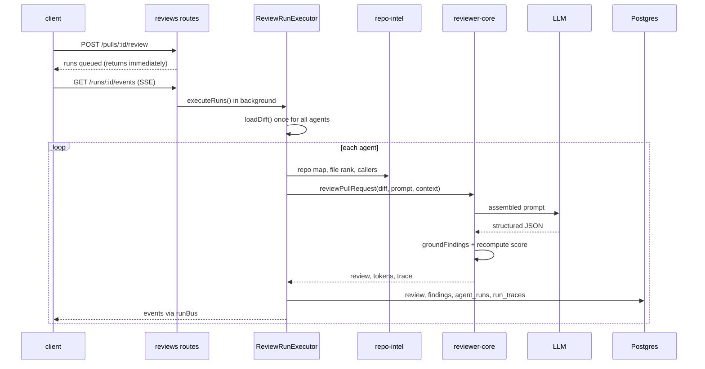

# DevDigest onboarding

How the modules connect, what the stack is, and the non-obvious parts of the
codebase to know before your first change.

## Goal

DevDigest is a **local-first AI pull-request reviewer**. You add a GitHub repo,
the server clones and indexes it, you import PRs, and LLM "agents" review the
diff and return structured findings with a severity and a score. The only
outbound calls go to GitHub and the LLM provider.

> This repo is the **starter template for the AI Agentic Engineering course**.
> It is deliberately minimal: each lesson (L01–L08) adds one feature back, such
> as cost badges, skills, Blast Radius, eval, multi-agent review and memory.
> Much of the scaffolding exists for features that aren't built yet.

## Stack

| Package | What it is | Tech |
|---|---|---|
| `client/` (:3000) | The studio web app | Next.js 15, React 19, TanStack Query, Tailwind 4, next-intl, mermaid, recharts |
| `server/` (:3001) | API and orchestration | Fastify 5, Drizzle ORM, Postgres + pgvector (Docker), Zod via `fastify-type-provider-zod`, SSE, p-queue |
| `reviewer-core/` | Pure review engine | TypeScript only: prompt → LLM → structured output → grounding. No DB, filesystem or GitHub. |
| repo-intel | Codebase indexer, in `server/src/modules/repo-intel` | `@ast-grep/napi`, dependency-cruiser, PageRank, js-tiktoken, ripgrep |
| `e2e/` | Browser end-to-end flows | agent-browser, deterministic (no LLM) |

LLM providers: OpenAI, Anthropic and OpenRouter. Tests use Vitest in every
package, with testcontainers for the DB-backed ones.

## How the modules talk to each other

Solid arrows are calls; dashed arrows are streaming or type-only links.
reviewer-core is consumed as TypeScript source through a path alias, not as a
built package.

### Who owns what

- **client** only talks to the API through `apiFetch` in
  `client/src/lib/api.ts`, wrapped by TanStack Query hooks. Live run progress
  arrives over SSE; index status is polled every 1.5s.
- **server modules** each own `modules/<name>/routes.ts` and get everything
  external from the DI container, so tests can swap in mocks from
  `adapters/mocks.ts`.
- **repo-intel** does its heavy work once, at clone time, through background
  jobs. A review only reads the precomputed index.
- **reviewer-core** is pure. Its only side effect is an LLM call through an
  injected `LLMProvider`.

## What happens when you click Review

1. `POST /pulls/:id/review` is capped at 10 requests a minute. It queues one
   run per agent and returns at once.
2. `ReviewRunExecutor.executeRuns` loads the diff once. If that fails, every
   queued run is marked failed.
3. For each agent it resolves the LLM provider (a missing key becomes a failed
   run, not a crash), then gathers repo-intel context if the agent's toggle is
   on.
4. `reviewPullRequest` assembles the prompt, calls the model, parses the output
   and runs the grounding gate.
5. The executor saves the review and findings, marks the PR head SHA as
   reviewed, and writes `agent_runs` plus one `run_traces` document.

## Unusual details

- **Not a monorepo workspace, and not one package manager.** Each package has
  its own lockfile. server and client use pnpm; reviewer-core and e2e use npm.
  Code is shared through tsconfig `paths`. reviewer-core never emits JS; its
  build is a type-check.
- **Two copies of `@devdigest/shared`, and they have drifted.** The server copy
  (`server/src/vendor/shared`) has the `openrouter` provider, `AgentManifest`,
  `AgentVersionConfig` and extra git/GitHub adapter methods that the client
  copy (`client/src/vendor/shared`) lacks. reviewer-core reads the server copy.
  Change a contract in both places by hand.
- **reviewer-core resolves `zod` from its own `node_modules`.** It imports the
  server's shared files but maps `zod` locally, so it needs its own
  `npm install`.
- **The schema already holds every lesson's tables.** Tables like eval, ci,
  knowledge and skills sit empty. `client/messages/en/*.json` likewise has
  strings for features that don't exist yet.
- **Migrations never run on boot.** A `relation … does not exist` error means
  you need `pnpm db:migrate`.
- **Secrets live outside the repo and the DB.** They are stored in
  `~/.devdigest/secrets.json` (mode 0600), with `.env` as a fallback, and are
  always read through `LocalSecretsProvider`. After a key changes, call
  `container.invalidateSecretCaches()`.
- **Leftovers from code that isn't here.** `.gitignore` mentions
  `agent-runner/dist`, comments refer to a CI agent-runner and task IDs like
  T1.3 and T3, and `server/src/platform/{grounding,prompt,structured}.ts` are
  only re-exports of reviewer-core.
- **Two identical `docker-compose.yml` files.** One is at the root and one in
  `server/`. `scripts/dev.sh` uses the root one.
- **Runtime state assumes one process.** The SSE `runBus` and the job queue are
  in memory, and the boot-time reaper assumes one API instance per database.
  Restarting the API marks in-flight runs as failed.

## Watch out for

- **Grounding is the core guarantee.** A finding that cites a line not in the
  diff is dropped, and the score is recomputed from what survives; the model's
  own score is ignored. If findings disappear, read the grounding summary in
  the run trace first.
- **Prompt-injection defense lives in one place:** `INJECTION_GUARD` and
  `wrapUntrusted` in `reviewer-core/src/prompt.ts`. Nothing keyword-scans
  untrusted text, by design. Anything you add to the prompt that comes from the
  PR must go through `wrapUntrusted`.
- **Repo intel fails silently.** An unindexed repo falls back to a diff-only
  review with no error. If reviews look shallow, check the Indexed badge or
  `GET /repos/:id/index-state`.
- **Register modules by hand, and use the container.** Add
  `modules/<name>/routes.ts` and register it in `modules/index.ts`; there is no
  autoload. Never construct adapters directly, or tests can't inject mocks.
- **Test file names decide where tests run.** Any test that touches the DB must
  be named `*.it.test.ts`. Otherwise it lands in the hermetic unit job in CI and
  fails there.
- **One route still parses its body manually.** Routes declare Zod schemas and
  reject bad input with a 422 before the handler runs. The exception is
  `POST /pulls/:id/review`, which still calls `RunRequest.parse` itself.

## Your first hour

1. Run `./scripts/dev.sh`. It starts Postgres, creates `.env` files, installs
   dependencies, migrates and seeds.
2. Open http://localhost:3000 and add an LLM key in Settings.
3. Open the seeded PR, `acme/payments-api` #482, and click Review.
4. Follow the code path: `server/src/modules/reviews/run-executor.ts` →
   `reviewer-core/src/review/run.ts` → `reviewer-core/src/prompt.ts` →
   `reviewer-core/src/grounding.ts`.
5. Then read [`server/README.md`](../server/README.md),
   [`reviewer-core/README.md`](../reviewer-core/README.md),
   [`server/src/modules/repo-intel/README.md`](../server/src/modules/repo-intel/README.md)
   and [`TESTING.md`](../TESTING.md).
